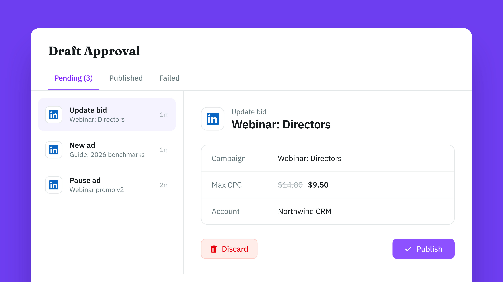

# LinkedIn Ads MCP Server

[](https://registry.modelcontextprotocol.io/v0/servers?search=io.github.adkit/linkedin-ads) [](https://adkit.so/features/ads-mcp/linkedin) [](./LICENSE)

Connect LinkedIn Ads to Claude, ChatGPT, Cursor, Codex or any AI app that supports MCP. AdKit hosts the server, so you only add an address to your AI app.

- **MCP address:** `https://mcp.adkit.so/linkedin-ads`
- **Website:** [AdKit](https://adkit.so/features/ads-mcp/linkedin)

Every change is saved as a draft first, so your AI can't spend money on its own. Nothing goes live on LinkedIn Ads until you approve it.



## What you can do

- Create and edit LinkedIn campaigns, ad groups and ads
- Find targeting values: locations, job titles, industries and other audience facets
- Upload images and videos to your ad account
- Read spend, leads and engagement results

## Example prompts

- "How much did each LinkedIn campaign spend per lead last month?"
- "Create a campaign that targets marketing directors at US software companies. Save it as a draft."
- "Which ads have the lowest CTR this month?"

## Set up

You need an AdKit account. On first use, you sign in to AdKit and connect your LinkedIn Ads account.

There are two ways to connect:

- **All platforms:** the main AdKit connector. One connection for Google, Meta, TikTok, LinkedIn, Microsoft, Reddit, X and Pinterest. Pick this if you run ads on more than LinkedIn Ads.
- **LinkedIn Ads only:** the address above. Your AI only sees the LinkedIn Ads tools.

### Claude (web and desktop)

- **All platforms:** [install AdKit from the Claude directory](https://claude.ai/directory/adkit), in one click.
- **LinkedIn Ads only:** Settings → **Connectors** → **Add custom connector** → paste `https://mcp.adkit.so/linkedin-ads`.

### ChatGPT

- **All platforms:** [add the AdKit app](https://chatgpt.com/apps/adkit/asdk_app_6a1e848decdc8191a4974b315c51661f), in one click.
- **LinkedIn Ads only:** Settings → **Connectors** → **Add custom connector** → paste `https://mcp.adkit.so/linkedin-ads`.

### Claude Code

As a plugin:

```
/plugin marketplace add adkit/linkedin-ads-mcp
/plugin install linkedin-ads@adkit-linkedin-ads
```

Or as an MCP server only:

```
claude mcp add --transport http adkit-linkedin-ads https://mcp.adkit.so/linkedin-ads
```

### Gemini CLI

```
gemini extensions install https://github.com/adkit/linkedin-ads-mcp
```

### Cursor

Add to `~/.cursor/mcp.json`:

```json
{
  "mcpServers": {
    "adkit-linkedin-ads": {
      "url": "https://mcp.adkit.so/linkedin-ads"
    }
  }
}
```

### Codex

Add to `~/.codex/config.toml`:

```toml
[mcp_servers.adkit-linkedin-ads]
url = "https://mcp.adkit.so/linkedin-ads"
```

In Claude Code, Gemini CLI, Cursor and Codex, use `https://mcp.adkit.so` instead to connect all platforms.

## Tools

| What | Tools |
| --- | --- |
| Ad accounts | `linkedin_ads_accounts_connect`, `linkedin_ads_accounts_disconnect`, `linkedin_ads_accounts_read` |
| Campaigns | `linkedin_ads_campaigns_create`, `linkedin_ads_campaigns_read`, `linkedin_ads_campaigns_update` |
| Ad groups | `linkedin_ads_ad_groups_create`, `linkedin_ads_ad_groups_read`, `linkedin_ads_ad_groups_update` |
| Ads | `linkedin_ads_ads_create`, `linkedin_ads_ads_read`, `linkedin_ads_ads_update` |
| Targeting values | `linkedin_ads_targeting_read` |
| Media library | `linkedin_ads_media_read` |
| Results and reporting | `linkedin_ads_results_read` |
| Media upload | `linkedin_ads_upload` |
| Direct API requests | `linkedin_ads_platform_api_request_mutate` |

Every AdKit connector also has these tools:

| Tool | What it does |
| --- | --- |
| `adkit_projects` | List your AdKit projects and pick one |
| `adkit_status` | Show the connected ad accounts |
| `adkit_setup` | Get the link to connect an ad account |
| `adkit_drafts_read` | List saved drafts, or read one |
| `adkit_drafts_update` | Edit a draft before it goes live |
| `adkit_drafts_delete` | Delete a draft |
| `adkit_drafts_publish` | Publish drafts after you approve them |
| `adkit_help` | Look up fields, limits and examples |
| `adkit_feedback` | Report a bug or a missing feature |

## FAQ

### What is the LinkedIn Ads MCP server?

A hosted MCP server from AdKit. It lets Claude, ChatGPT, Cursor, Codex and other AI apps work on your LinkedIn Ads account: LinkedIn campaigns, ad groups, ads, targeting and reports.

### Is the LinkedIn Ads MCP server free?

It is included in every AdKit plan. Plans start at $29 a month, with a 7-day free trial. See [pricing](https://adkit.so/pricing).

### Can my AI change my LinkedIn Ads without asking me?

No. Every create, edit or pause is saved as a draft. It goes live only after you approve it, on AdKit's Draft Approval page or by telling your AI to publish it.

### Do I need an API key or a developer token?

No. You sign in to AdKit in your browser and connect your LinkedIn Ads account there.

### Can I manage several LinkedIn Ads accounts?

Yes. Connect several accounts and keep each client in its own AdKit project. How many projects you get depends on your plan.

### Which AI apps does it work with?

Claude, ChatGPT, Claude Code, Gemini CLI, Cursor, Codex and any app that supports remote MCP servers with OAuth sign-in.

## Other ad platforms

- [Meta Ads MCP Server](https://github.com/adkit/meta-ads-mcp)
- [Google Ads MCP Server](https://github.com/adkit/google-ads-mcp)
- [TikTok Ads MCP Server](https://github.com/adkit/tiktok-ads-mcp)
- [Microsoft Ads MCP Server](https://github.com/adkit/microsoft-ads-mcp)
- [Reddit Ads MCP Server](https://github.com/adkit/reddit-ads-mcp)
- [X Ads MCP Server](https://github.com/adkit/x-ads-mcp)
- [Pinterest Ads MCP Server](https://github.com/adkit/pinterest-ads-mcp)
- [All platforms in one connector](https://github.com/adkit/ads-mcp)

## Support and policies

- Help: [adkit.so/support](https://adkit.so/support) or contact@adkit.so
- [Privacy](./PRIVACY.md), [Terms](./TERMS.md), [Security](./SECURITY.md), [Support](./SUPPORT.md)

## Docs server

[`docs-server/`](./docs-server/index.mjs) is a small local MCP server that answers questions about AdKit from this README: setup per AI app, hosted tools, ad platforms, example prompts and the FAQ. It needs no login and does not manage ads; for that, connect the hosted server above. Run it with `npm start` or the Dockerfile.

## License

MIT
